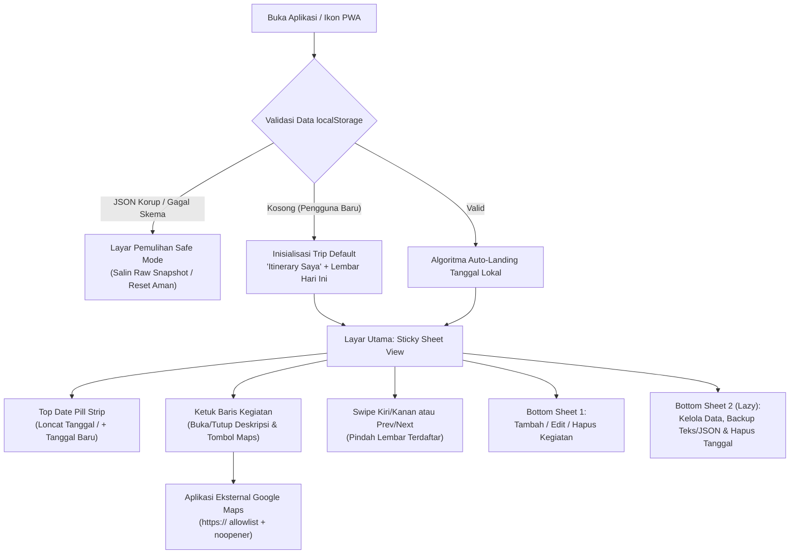

# App Flow Document: StickyPlan v1.0

**Status:** Baseline Persiapan MVP v1.0  
**Referensi Utama:** [01-PRD.md](./01-PRD.md) | [02-TRD.md](./02-TRD.md)

---

## 1. Peta Arsitektur Layar (Single-Screen SPA + 2 Bottom Sheets)

StickyPlan menjaga fokus *one-handed mobile use* tanpa perpindahan halaman (*page reload*) yang membingungkan:

---

## 2. Detail Alur Pengguna Inti (User Journeys)

### Alur 1: Cold Start & Auto-Landing Tanggal Hari Ini (< 1 Detik)
1. Aplikasi menghitung `todayLocal` (`YYYY-MM-DD`) menggunakan kalender lokal perangkat (`getFullYear`, `getMonth`, `getDate` — **bukan** UTC `toISOString`).
2. Daftar `day_sheets` pada trip aktif diurutkan berdasarkan `date ASC`:
   - **Kasus A (Tepat Hari Ini):** Ada `sheet.date === todayLocal` -> langsung aktifkan lembar tersebut + gulir *pill* aktif ke tengah *Date Pill Strip*.
   - **Kasus B (Di Sela Hari Trip / Sebelum Berangkat):** Ada lembar dengan `sheet.date > todayLocal` -> aktifkan lembar mendatang terdekat.
   - **Kasus C (Setelah Trip Selesai):** Semua `sheet.date < todayLocal` -> aktifkan lembar pertama trip agar mudah dibaca dari awal.
   - **Kasus D (Belum Ada Lembar Tanggal):** Tampilkan *Empty State* ramah dengan satu tombol aksi utama **+ Tambah Tanggal Pertama**.

### Alur 2: Navigasi 3 Arah Antar Hari
1. **Date Pill Strip (Atas):** Pengguna mengetuk *pill* tanggal (`Rab, 25 Nov`) untuk lompat instan dari Hari 1 ke Hari 7 dalam 1 ketukan, atau mengetuk `+ Tanggal` untuk menambah tanggal baru (dengan validasi anti-duplikat `trip_id + date`).
2. **Thumb Bar `Prev` / `Next` (Bawah):** Berpindah ke indeks lembar sebelum/sesudahnya dalam daftar `day_sheets` yang terdaftar (misal `25 Nov` langsung lompat ke `27 Nov` jika `26 Nov` tidak didaftarkan). Tombol otomatis `disabled` saat berada di ujung paling awal/akhir.
3. **Swipe Horizontal pada Kartu Sticky:**
   - Menggeser kartu ke kiri = `Next`; menggeser ke kanan = `Prev`.
   - Syarat aktif: `|dx| >= 56px` dan `|dx| > 1.8 * |dy|`, tidak sedang menyeleksi teks kode *booking*, dan tidak dimulai dari elemen interaktif/scroll horizontal.

### Alur 3: Membaca Detail Kegiatan & Buka Google Maps (< 5 Detik)
1. Secara default semua baris tampil ringkas: `09:00` | `Rapat Koordinasi Kemenkomdigi` | `[ikon pin lokasi]` | `[chevron]`.
2. Pengguna mengetuk baris kegiatan -> panel *accordion* terbuka mulus menampilkan:
   - Deskripsi lengkap (mendukung baris baru `whitespace-pre-line`, teks bisa disalin untuk nomor kursi/kode booking).
   - Tombol aksi jelas **Buka di Google Maps** (hanya tampil jika `maps_url` valid tersedia) + tombol sekunder **Edit**.
3. Mengetuk **Buka di Google Maps** membuka tautan `https://` yang telah disanitasi di tab baru / aplikasi native Google Maps (`target="_blank" rel="noopener noreferrer"`).

### Alur 4: Tambah, Edit, & Hapus Kegiatan (< 15 Detik)
1. Pengguna mengetuk tombol tengah `+ Kegiatan` di *Bottom Bar* (atau tombol `Edit` di dalam *accordion*).
2. **Bottom Sheet Form** muncul (`max-h-[88dvh]`, aman dari tertutup keyboard HP):
   - **Jam Mulai (`<input type="time">`):** Wajib (`HH:mm` 24 jam). Default cerdas: jam bulat berikutnya atau `09:00`.
   - **Judul Kegiatan:** Wajib, `1..80` karakter, indikator sisa karakter muncul saat mendekati batas.
   - **Link / Nama Lokasi Google Maps (Opsional):**
     - Jika ditempel teks *Share* Google Maps (`"Grand Indonesia https://maps.app.goo.gl/abc"`), parser otomatis mengekstrak URL `https://` resmi.
     - Jika diketik nama tempat polos (`"Stasiun Gambir"`), muncul chip pratinjau `"Akan dibuka sebagai pencarian Google Maps: Stasiun Gambir"`.
     - Jika ditempel URL berbahaya (`javascript:...` atau domain asing), tampilkan pesan validasi jelas dan blokir penyimpanan.
   - **Deskripsi / Catatan (Opsional):** Maksimal `1.000` karakter (nomor kursi, kode PNR, dress code, kontak PIC).
3. Saat klik **Simpan**:
   - Input divalidasi dengan *strict DTO allow-list* (tanpa *raw spread*), disimpan ke `localStorage`, *Bottom Sheet* menutup, dan baris kegiatan tersisip otomatis pada urutan `start_time ASC, sort_order ASC` dengan sorotan halus sesaat.
4. **Hapus Kegiatan (Destruktif — Non-Optimistic, Konfirmasi 2 Langkah):**
   - Pada mode Edit, mengetuk `Hapus Kegiatan` mengubah tombol menjadi konfirmasi eksplisit `Yakin Hapus?` + `Batal` selama 4 detik sebelum benar-benar menghapus dari storage.

### Alur 5: Backup (JSON & Teks WA), Import Aman, & Hapus Tanggal
1. Pengguna mengetuk ikon **Menu / Kelola Data** di *Top Bar* -> membuka **Bottom Sheet Kelola Data** (dimuat *lazy*).
2. Menampilkan status: **`Terakhir di-backup: Belum pernah`** (atau tanggal/jam ekspor terakhir).
3. **Aksi Tersedia:**
   - **Unduh Backup (`.json`):** Menghasilkan file `stickyplan-backup-YYYY-MM-DD.json` dan memperbarui timestamp `last_exported_at`.
   - **Salin Teks Jadwal (Format WhatsApp):** Menyalin jadwal rapi ke *clipboard* dengan umpan balik `"Jadwal berhasil disalin!"`.
   - **Impor Backup (`.json`):**
     1. Cek ukuran file (`<= 2 MB`), parse JSON dengan penolakan key `__proto__`/`constructor`/`prototype`, dan validasi seluruh struktur & relasi.
     2. Jika gagal validasi: tolak file, tampilkan alasan spesifik dalam Bahasa Indonesia, dan **jangan sentuh data lama**.
     3. Jika valid dan sudah ada jadwal lokal: minta pengguna memilih **Ganti Semua Data** (disertai tombol unduh backup data saat ini) atau **Gabungkan Jadwal**.
   - **Hapus Lembar Tanggal Aktif:** Wajib konfirmasi 2 langkah yang menyebutkan jumlah pasti kegiatan di dalamnya (misal: *"Hapus Rabu, 25 Nov beserta 5 kegiatan di dalamnya?"*).

---

## 3. Matriks Kelengkapan 6-State UI

Setiap komponen layar wajib menangani ke-6 state berikut secara eksplisit:

| State | Perilaku UI di StickyPlan |
| :--- | :--- |
| **1. Empty (Trip / Hari Kosong)** | Kartu kertas bersih dengan pesan singkat lugas (`"Belum ada kegiatan di tanggal ini"`) dan tombol primer `+ Tambah Kegiatan Pertama`. |
| **2. Loading / Lazy Sheet** | App utama instan (`0ms` spinner karena baca sinkron lokal); *lazy bottom sheet* menampilkan kerangka tipis tanpa menggeser layout. |
| **3. Populated (Normal)** | Daftar kegiatan terurut rapi per jam `tabular-nums`, indikator lokasi, *pill* tanggal aktif, dan penghitung posisi (`Hari 1 dari 3`). |
| **4. Validation Error** | Pesan error spesifik tepat di bawah field terkait (`role="alert"`), fokus diarahkan ke field yang salah tanpa menghapus ketikan pengguna. |
| **5. Offline / Airplane Mode** | Seluruh baca/tulis berjalan 100% normal; indikator kecil tenang `"Offline siap"` tampil hanya saat perangkat kehilangan sinyal agar pengguna tenang. |
| **6. Quota Full / Corrupt Safe Mode** | Jika `QuotaExceededError`: tampilkan banner peringatan untuk segera klik Export JSON. Jika storage korup saat boot: tampilkan layar **Safe Mode** dengan opsi salin teks mentah & tombol *Reset Safe Mode*. |
